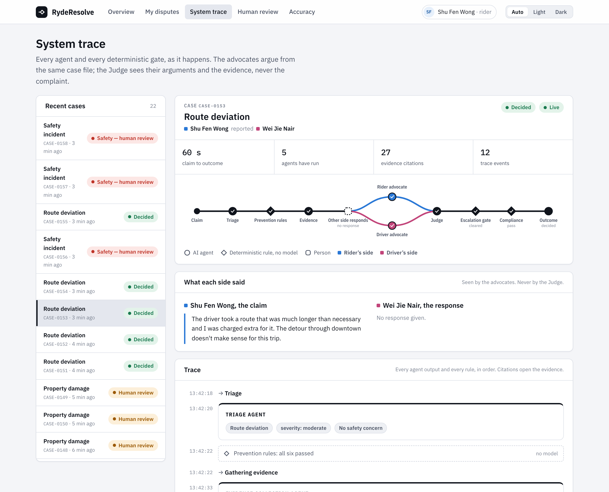
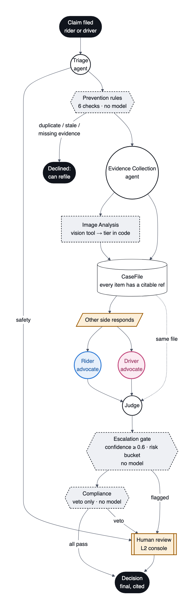
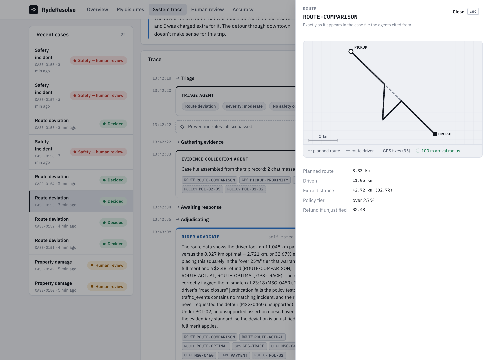
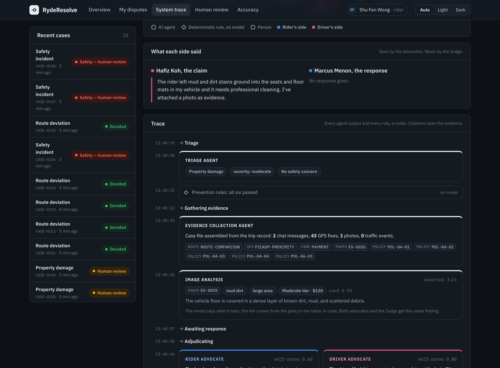
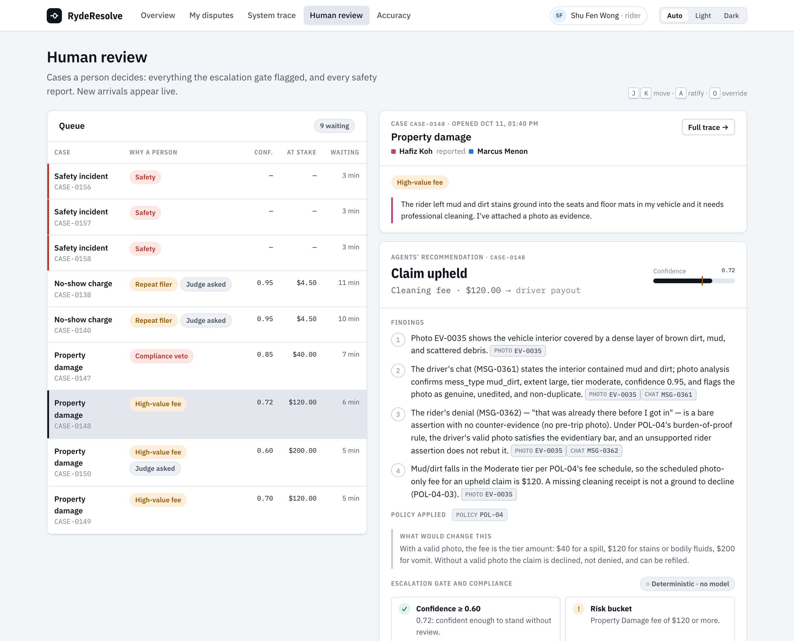
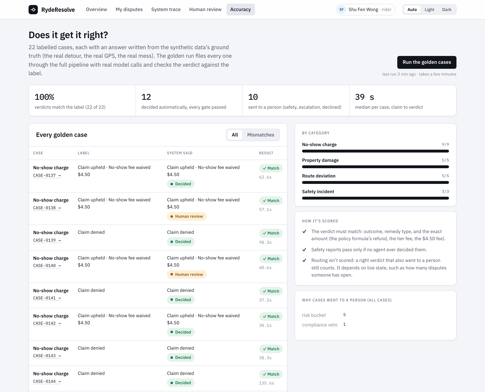
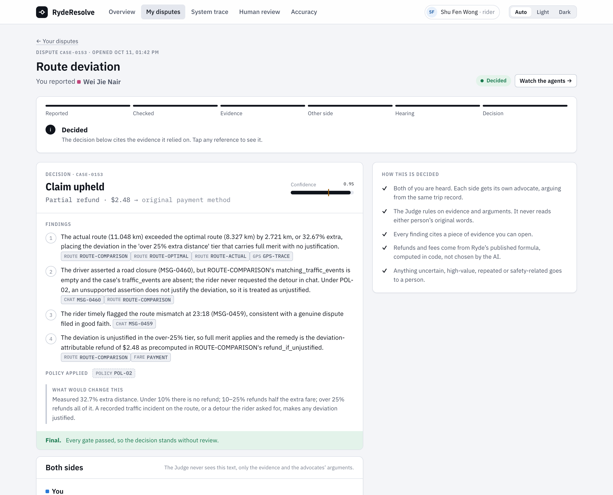
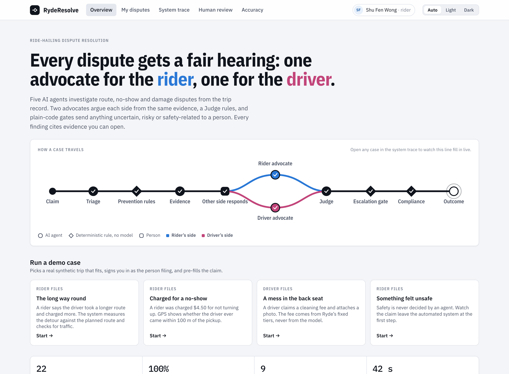
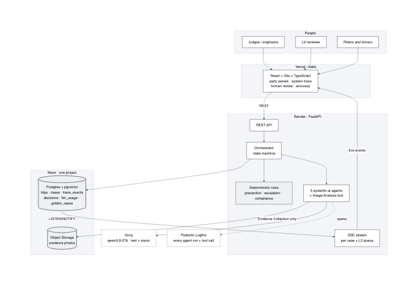

# RydeResolve

A multi-agent dispute resolution system for Ryde's ride-hailing platform, built for the Tencent hackathon. Every rider/driver dispute gets a fair hearing: one AI advocate for the rider, one for the driver, a Judge that rules on the evidence, and plain-code gates that send anything uncertain, high-value, repeated or safety-related to a person. Every finding cites a piece of evidence you can open.

**Scope:** three of Ryde's four dispute categories: Route Deviation, No-Show Charge and Property Damage. Safety Incidents always go straight to a human reviewer and are never decided by an agent.



## Results

The **golden run** files 22 labelled cases through the full pipeline with real model calls and checks each verdict against a label written from the synthetic data's ground truth: the real detour, the real GPS, the real mess.

| | |
|---|---|
| Verdicts matching the label | **22 / 22** on Qwen3-235B (DeepInfra), 2026-10-14, on the regenerated dataset with real OneMap routes. Qwen3.6-27B also 22 / 22. Earlier tuning progression: 14 → 19 → 21 → 21 → 22 |
| Decided with no person involved | 12 of 22. The other 10 are safety reports, high-value fees, repeat filers, and cases the Judge was unsure of |
| Median time, claim to verdict | about 2.5–3 minutes per golden case on DeepInfra (it was about 40 seconds on Groq) |
| Tokens per fully argued case | about 124K input and 2.3K output on Qwen3-235B, about $0.012 a case. A safety report uses about 0.8K, because it stops at Triage |

Run it yourself from the **Accuracy** page, or with `POST /golden-run`. Per-call token usage is recorded in the `llm_usage` table.

## How it works



Deterministic orchestrator code wires five `pydantic-ai` agents together; agents never call each other.

1. **Triage Agent** reads the claim, sets the category and severity, and flags safety. Safety reports leave the automated system here.
2. **Prevention Rules** are six deterministic checks with no model: duplicate, malformed, safety hard-stop, required evidence, repeat filer, and the 30-day window.
3. **Evidence Collection Agent** assembles one `CaseFile` from Postgres and object storage. It is the only agent with data access. Every item gets a citable ref (`MSG-0459`, `EV-0035`, `ROUTE-COMPARISON`, ...). Policy tests are computed in code rather than estimated by a model:
   - planned vs driven distance, and the refund formula;
   - the closest GPS approach to the pickup;
   - whether a traffic incident lies on the planned route.
4. **Image Analysis** grades each damage photo with a vision call: what kind of mess, and how much of the seat or floor it covers. Code maps that to Ryde's fee tier, so the model never picks the fee.
5. **Rider Advocate and Driver Advocate** run in parallel on the identical case file. A citation validator strips any claim that doesn't resolve to real evidence.
6. **Judge** weighs both arguments and the evidence. It never sees the original complaint text. Dollar amounts that the policy fixes are filled in code.
7. The **escalation gate** runs on every case. It escalates when confidence is below 0.6, or when the case falls in a risk bucket: repeat filer, damage fee of $120 or more, or safety.
8. The **compliance check** can veto a decision but never write one.

Anything flagged goes to the **human review** queue, where a reviewer ratifies or overrides the recommendation, with a structured reason.

<table>
<tr>
<td width="50%"><br><sub>Any citation opens the evidence it points to.</sub></td>
<td width="50%"><br><sub>Image Analysis: the model says what it sees, and code maps that to the tier.</sub></td>
</tr>
<tr>
<td><br><sub>Human review: why each case needs a person, the agents' recommendation, gate checks.</sub></td>
<td><br><sub>Accuracy: the golden run, case by case.</sub></td>
</tr>
<tr>
<td><br><sub>What the rider sees: progress, the ruling, and how it was decided.</sub></td>
<td><br><sub>One-click demo cases for all four categories.</sub></td>
</tr>
</table>

## Architecture



- **Frontend:** React (Vite) + TypeScript, a static bundle on Vercel. It has:
  - a landing page with demo cases;
  - Rider and Driver panels;
  - a live System Trace with an evidence drawer;
  - the Human review console;
  - the Accuracy page.

  It has light and dark themes. See [`frontend/README.md`](frontend/README.md).
- **Backend:** Python + FastAPI on Render: one service owning orchestration, the deterministic rules, and all agent calls.
- **Agents:** `pydantic-ai`; Qwen3-235B on DeepInfra by default with Qwen3.6-27B as fallback, and Gemini Flash for photos. Any DeepInfra, NVIDIA, OpenRouter or Google model can be set by env var, instrumented with Pydantic Logfire (every agent run and tool call).
- **Data:** Neon Postgres + pgvector (trips, cases, trace events, decisions, golden cases, LLM usage). Evidence photos are in Neon Object Storage, in the same project.
- **Transport:** REST for actions; Server-Sent Events for everything live, backed by Postgres `LISTEN/NOTIFY` and resumable with `Last-Event-ID`.

Policy figures are labelled as either real Ryde-sourced figures (no-show fee $4.50, cleaning-fee caps $40/$120/$200, the 30-day window) or our own design choices (the route-deviation tiers, the 100 m arrival radius, the 2 km traffic-match radius). See the [policy doc](docs/RydeResolve-Policy-and-Prevention-Rules.md).

## Documentation

| Document | Covers |
|---|---|
| [System Design & Architecture](docs/RydeResolve-System-Design.md) | Client/backend/data-layer design, the five-agent roster, escalation gates, deployment, submission-requirements mapping |
| [Dispute Resolution Policy & Prevention Rules](docs/RydeResolve-Policy-and-Prevention-Rules.md) | The policy corpus used for Policy RAG and the six Prevention Rules, each labelled real-Ryde-sourced or our own |
| [Data Sources & Generation Strategy](docs/RydeResolve-Data-Sources-and-Strategy.md) | Where each data point comes from (real API, synthetic, semi-dummy) and the synthetic-dataset pipeline |
| [Deploy (Render + Vercel)](docs/RydeResolve-Deploy-Backend.md) | Step-by-step deploy, smoke test, golden-path walkthrough |

## Run it locally

```bash
cd backend && uv sync && uv run uvicorn app.main:app --port 8000      # needs the root .env
cd frontend && npm install && npm run dev                             # http://localhost:5173
```

- **Database:** Neon already holds 200 synthetic trips, 65 users and 22 golden cases. Schema: `backend/migrations/0001_init.sql` and `0002_llm_usage.sql`.
- **Dates:** before a demo, run `uv run python -m scripts.shift_dates` from `backend/` so every trip is inside the 30-day claim window.
- **Checks:**
  - `uv run pytest`: 160+ tests, no network.
  - `uv run python -m scripts.smoke_e2e`: three scenarios end to end against a running API.
  - `POST /golden-run`: the full labelled suite.
- **Regenerate the dataset:** `cd backend && uv run python -m data_generation.pipeline.generate --count 200 --seed 42`.

## Deployment (all free tier)

Vercel (frontend) + Render (backend) + Neon (Postgres/pgvector + object storage) + Pydantic Logfire. Steps are in [`docs/RydeResolve-Deploy-Backend.md`](docs/RydeResolve-Deploy-Backend.md).
