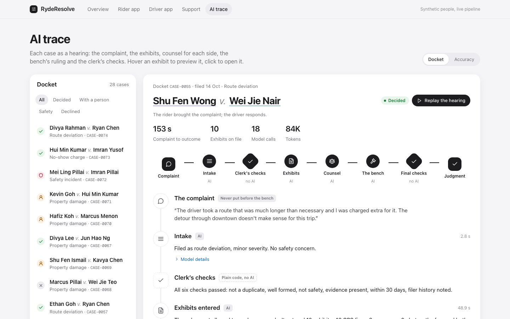
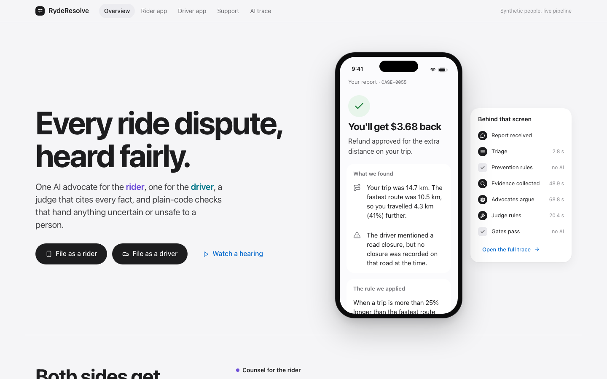
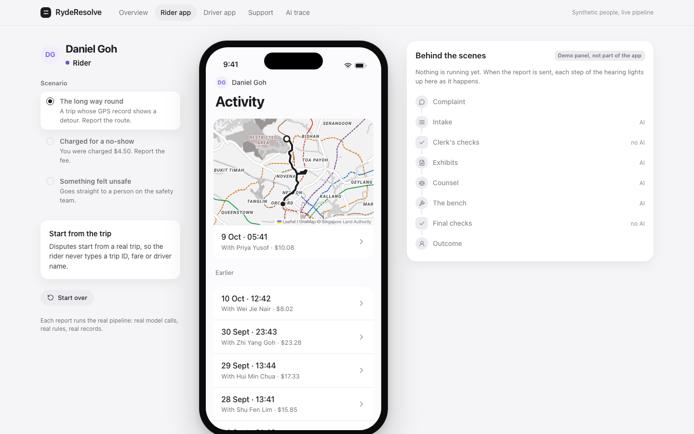
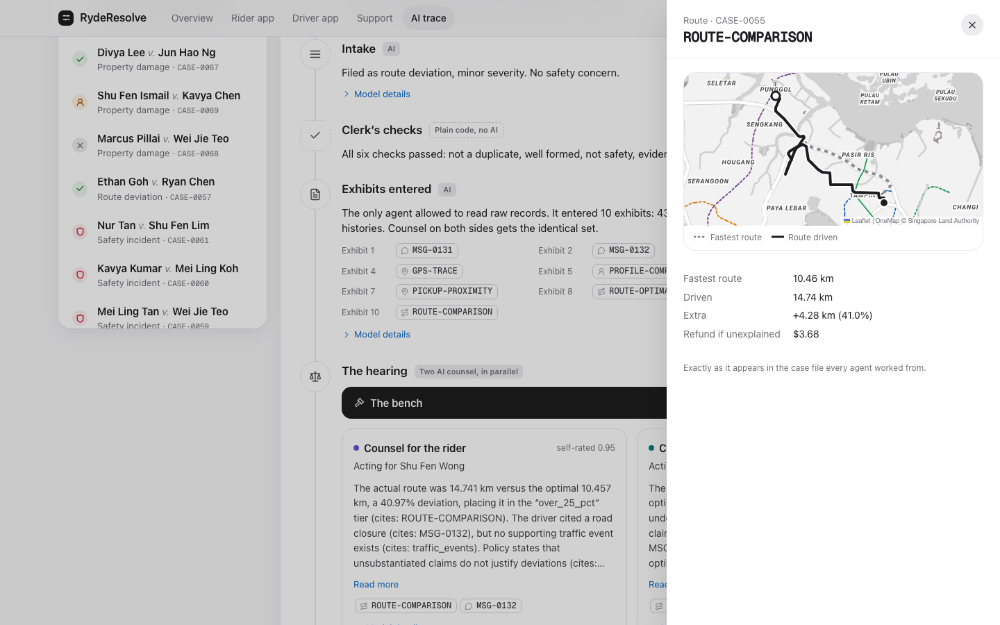
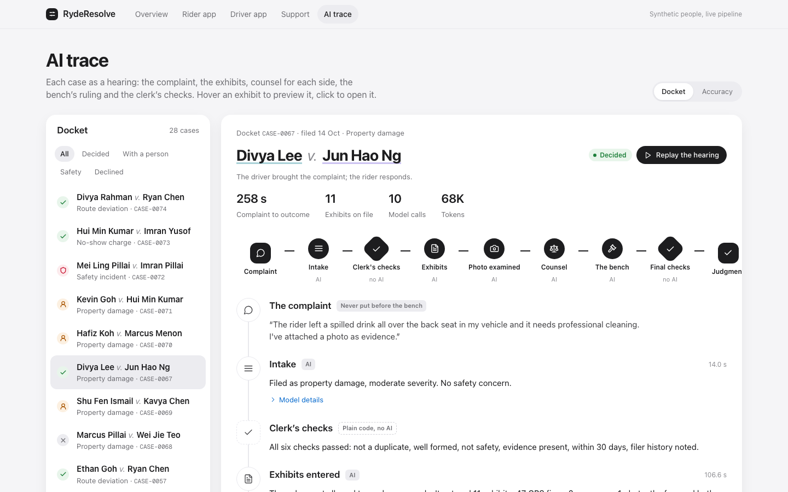
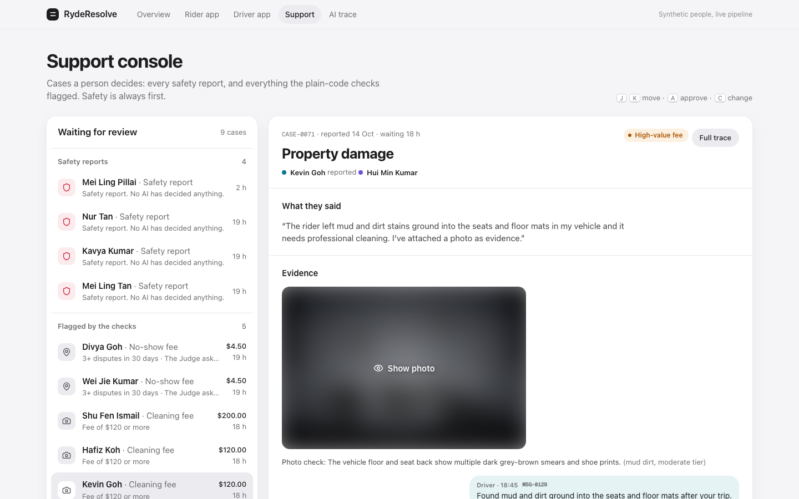
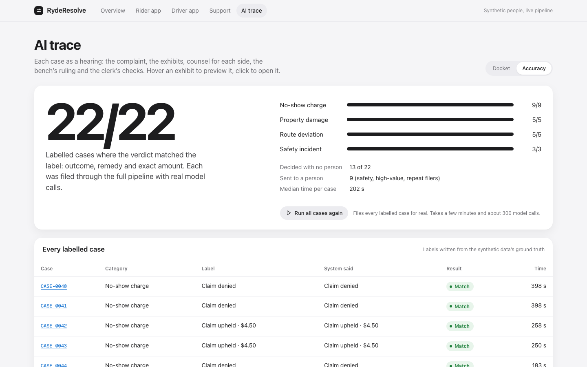

# RydeResolve

**Every ride dispute, heard fairly, on the evidence.**

RydeResolve settles everyday disputes between riders and drivers on a ride-hailing platform. Each dispute gets a hearing with three AI roles: one advocate argues for the rider, one argues for the driver, and a Judge rules on the evidence. Every finding cites a piece of evidence you can open. Plain-code checks then send anything uncertain, high-value, repeated or safety-related to a person.

Built for the Tencent Cloud hackathon (The Digital Native Track), with CodeBuddy and WorkBuddy.

**Live demo: [ryde-dispute-resolution-tencent.vercel.app](https://ryde-dispute-resolution-tencent.vercel.app)**

**Scope.** It covers three of Ryde's four dispute categories:

- **Route Deviation:** the driver took a longer route than necessary.
- **No-Show Charge:** a contested $4.50 no-show fee.
- **Property Damage:** a cleaning fee for a mess left in the car.

The fourth category, **Safety Incidents**, always goes straight to a person. No AI ever decides one.



## Submission materials

| | |
|---|---|
| Live demo | [ryde-dispute-resolution-tencent.vercel.app](https://ryde-dispute-resolution-tencent.vercel.app) |
| Cover image | [`submission/cover.png`](submission/cover.png) |
| Architecture deck | [`submission/architecture.pptx`](submission/architecture.pptx): 8 slides covering the pipeline, permissions, citations, escalation, architecture, case lifecycle and results |
| CodeBuddy / WorkBuddy proof | [`submission/proof/`](submission/proof): screenshots, plus all of them in one PDF |

## Results

The **golden run** files 22 labelled cases through the full pipeline with real model calls. It checks each verdict against a label written from the synthetic data's ground truth: the real detour, the real GPS, the real mess.

| | |
|---|---|
| Verdicts matching the label | **22 of 22**, checked down to the outcome, remedy and exact amount. Qwen3-235B and Qwen3.6-27B (both on DeepInfra) each scored 22 of 22 |
| Decided with no person involved | 13 of 22. The other 9 were sent to a person: safety reports, cleaning fees of $120 or more, and repeat filers |
| Safety reports | 3 of 3 went to a person, untouched by AI |
| Time, claim to verdict | median 202 seconds per case |
| Model cost | about US$0.012 per fully argued case (about 124K input and 2.3K output tokens, recorded per call in `llm_usage`) |
| Photo grading | 20 of 20 on the sample photos, across every fee tier |
| Tests | 216 automated tests, no network needed |

Run it yourself from the **Accuracy** page, or with `POST /golden-run`.

## How it works


Plain orchestrator code connects five `pydantic-ai` agents. The agents never call each other.

1. **Triage Agent** reads the claim, sets the category and severity, and flags safety. Safety reports leave the automated system here.
2. **Prevention Rules** are six deterministic checks with no model:
   - duplicate claim;
   - malformed claim;
   - safety hard stop;
   - required evidence present;
   - repeat filer;
   - within the 30-day window.
3. **Evidence Collection Agent** assembles one case file from Postgres and object storage. It is the only agent with data access. Every item gets an ID that can be cited, such as `MSG-0459`, `EV-0035` or `ROUTE-COMPARISON`. Policy tests are computed in code, not estimated by a model:
   - planned versus driven distance, and the refund formula;
   - the closest GPS approach to the pickup point;
   - whether a traffic incident lies on the planned route.
4. **Image Analysis** grades each damage photo: what kind of mess it is, and how much of the seat or floor it covers. Code maps that to Ryde's fee tier, so the model never picks the fee.
5. **Rider Advocate and Driver Advocate** argue in parallel from the identical case file. A citation validator strips any claim that doesn't point to real evidence.
6. **Judge** weighs both arguments and the evidence. It never sees the original complaint text. Any dollar amount the policy fixes is filled in by code.
7. **Escalation gate** runs on every case. It sends the case to a person when the Judge's confidence is below 0.6, or when the case falls in a risk bucket: repeat filer, damage fee of $120 or more, or safety.
8. **Compliance check** can veto a decision, but never write one.

A flagged case goes to the **support console**. There, a person approves the recommendation or changes it, and records a reason.

<table>
<tr>
<td width="50%"><br><sub>The overview: what a party sees, and the steps behind it.</sub></td>
<td width="50%"><br><sub>The rider app. Disputes start from a real trip. The panel beside the phone is for the demo; the app never shows the AI.</sub></td>
</tr>
<tr>
<td><br><sub>Any citation opens the evidence it points to: here, the driven and fastest routes.</sub></td>
<td><br><sub>A cleaning-fee case: the photo is examined before counsel argue.</sub></td>
</tr>
<tr>
<td><br><sub>The support console: safety reports first, with the evidence shown before any recommendation.</sub></td>
<td><br><sub>Accuracy: the golden run, case by case.</sub></td>
</tr>
</table>

## Architecture


- **Frontend:** React (Vite) + TypeScript, a static bundle on Vercel. It contains:
  - the overview;
  - the rider and driver apps in phone frames;
  - the support console;
  - the AI trace, which shows each case as a hearing, plus the Accuracy page.

  See [`frontend/README.md`](frontend/README.md).
- **Backend:** Python + FastAPI on Render: one service that owns orchestration, the deterministic rules and every agent call.
- **Agents:** `pydantic-ai`, instrumented end to end with Pydantic Logfire, so every agent run and tool call is recorded.
  - The agents run on Qwen3-235B on DeepInfra, with Qwen3.6-27B as fallback.
  - Photos are graded by Gemma 4 on DeepInfra, with Gemini Flash as fallback.
  - The models are set by environment variable.
- **Data:** Neon Postgres + pgvector holds trips, cases, trace events, decisions, golden cases and model usage. Evidence photos are in Neon Object Storage, in the same project.
- **Maps:** real road routes from Singapore's OneMap, drawn on OneMap tiles.
- **Transport:** REST for actions. Server-Sent Events carry everything live, backed by Postgres `LISTEN/NOTIFY` and resumable with `Last-Event-ID`.

**Policy figures.** Every figure is labelled as one of two kinds:

- **Real, sourced from Ryde:** the $4.50 no-show fee, the $40/$120/$200 cleaning-fee caps and the 30-day dispute window.
- **Our own design choices:** the route-deviation tiers, the 100 m arrival radius and the 2 km traffic-match radius.

See the [policy doc](docs/RydeResolve-Policy-and-Prevention-Rules.md).

## Documentation

| Document | Covers |
|---|---|
| [System Design & Architecture](docs/RydeResolve-System-Design.md) | Client, backend and data-layer design, the five-agent roster, escalation gates, deployment, how each submission requirement is met |
| [Dispute Resolution Policy & Prevention Rules](docs/RydeResolve-Policy-and-Prevention-Rules.md) | The policy text the agents retrieve and cite, and the six Prevention Rules, each figure labelled as Ryde-sourced or our own |
| [Data Sources & Generation Strategy](docs/RydeResolve-Data-Sources-and-Strategy.md) | Where each data point comes from (real API, synthetic or semi-dummy) and the synthetic-data pipeline |
| [Deploy (Render + Vercel)](docs/RydeResolve-Deploy-Backend.md) | Step-by-step deploy, smoke test and walkthrough |

## Run it locally

You need Python 3.11 with [uv](https://docs.astral.sh/uv/), Node 20+, a Neon project (Postgres with pgvector, plus Object Storage), and a DeepInfra API key.

1. Copy the example environment file and fill it in. Each variable is explained in it.

   ```bash
   cp .env.example .env
   ```

2. Set up the database and the data, from `backend/`:

   ```bash
   uv sync
   psql "$DATABASE_URL" -f migrations/0001_init.sql
   psql "$DATABASE_URL" -f migrations/0002_llm_usage.sql
   uv run python -m data_generation.pipeline.generate --count 200 --seed 42   # synthetic trips, users, golden cases
   ```

3. Run it:

   ```bash
   cd backend && uv run uvicorn app.main:app --port 8000
   cd frontend && npm install && npm run dev                                  # http://localhost:5173
   ```

**Checks:**

- `uv run pytest`: the 216 automated tests.
- `uv run python -m scripts.smoke_e2e`: three scenarios end to end, against a running API.
- `POST /golden-run`: the full labelled suite.

**Dates:** claims are only allowed within 30 days of a trip. Before a demo, run `uv run python -m scripts.shift_dates` from `backend/`, which moves the synthetic timeline forward so every trip is recent.

## Deployment

The frontend is on Vercel and the backend on Render. Neon holds both Postgres/pgvector and object storage. All three run on free tiers; only the model calls are paid, per token. See the [deploy guide](docs/RydeResolve-Deploy-Backend.md).

## Data

Every person, trip, chat message and photo is synthetic. The road routes and map tiles are real, from OneMap.
