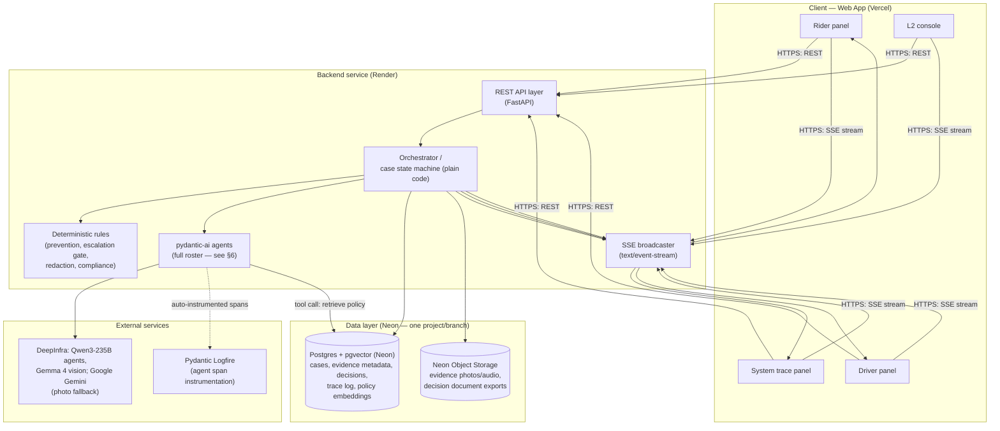
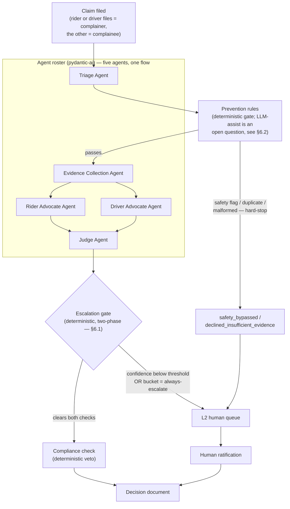
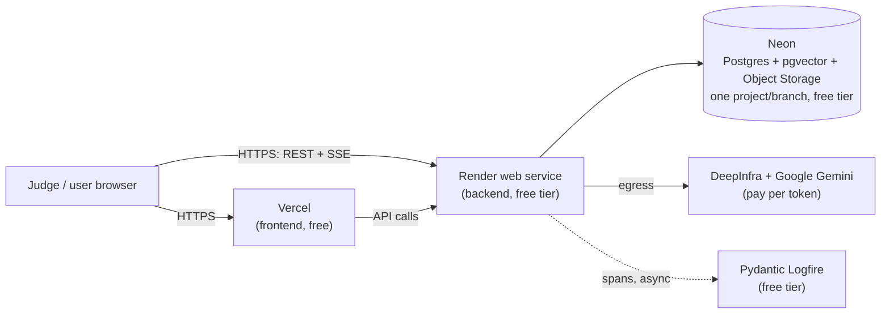

# RydeResolve — System Design & Architecture

**Status:** v15 (2026-10-14): adds the read endpoints the redesigned party screens use (trip detail, plain-language outcome, full trace, token usage, featured hearing) and the L2 "Prepare case file" action for safety reports (§4, step 10 in §6). Nothing else changed.

v14 (2026-10-11): brings the doc in line with what's built. Changes:
- Image Analysis runs once per photo after evidence assembly; the advocates' tool reads the stored finding (§6).
- Policy facts and fixed dollar amounts are computed in code (§6.4).
- `llm_usage` added to the data layer (§5).
- The SSE design is now Postgres LISTEN/NOTIFY rather than an in-process queue (§4).
- The API table lists the endpoints that actually exist (§4).
- The golden set is 22 cases (§5).

Nothing else changed. v13 — swaps object storage from Cloudflare R2 to Neon Object Storage (same Neon project/branch as Postgres, dropping R2 as a separate service) and locks the agent model string to `groq:qwen/qwen3.8-27b`; no other change from v12. v12 was: full five-agent roster, one unified section, one diagram, one table. Section 6 is no longer split into sub-sections by agent tier — Triage, Evidence Collection, Rider Advocate, Driver Advocate, and Judge are all presented together, in the body of §6 itself, with no "§6.1 core agents" vs. "§6.2 other agents" split. Evidence Collection is a full `pydantic_ai.Agent` — the fourth member of the roster alongside Triage, the two Advocates, and the Judge — not deterministic code and not a separate phase-2 addition. The end-to-end pipeline is: **Triage Agent** (auto-categorize + set safety flag) → **Prevention rules** (deterministic gate) → **Evidence Collection Agent** (assembles the `CaseFile`, with DB/Object Storage/Policy RAG tools) → parallel Rider/Driver Advocates (each with Evidence Lookup, Image Analysis, and Policy RAG tools) → Judge (with Policy RAG, Prevention-Rule Bucket, and Escalate-to-L2 tools) → a two-phase deterministic escalation gate (confidence threshold + case-classification bucket) → compliance check → decision document. The only tiering left anywhere in §6 is agents (reasoning) vs. deterministic gates (fixed rules) — never "core agents" vs. "supporting agents." Two items remain explicitly unresolved: whether verified evidence is shown to the complainee post-L2, and whether Prevention rules need any LLM assistance (see §6.2).
**Runway assumed:** ~2 weeks, 2 developers, AI coding assistants as a force multiplier
**Target:** live, effectively-zero-cost deployment reachable by judges

---

## 0. What this document is, and isn't

This is the system architecture: client, backend, data layer, and agentic design. It does not contain a day-by-day schedule or a per-developer task split — that's a later document. Data-source/content strategy (which corpora, which synthetic generators) is likewise out of scope beyond what the architecture needs to know about where data lives and how it's retrieved.

Decisions locked as of this revision:

1. **Vector store: Postgres + pgvector.** One managed data service does both structured storage and policy-clause retrieval — Neon's free tier.
2. **Agentic layer is built on `pydantic-ai`, five agents in one roster, one section.** Triage, Evidence Collection, Rider Advocate, Driver Advocate, and Judge are all `pydantic_ai.Agent` instances presented together in a single flow, diagram, and table — §6 has no sub-sections splitting agents into tiers. Evidence Collection is no longer deterministic code, and Triage is no longer a side addition; both are core, front-of-pipeline agents alongside the three the brief names directly. Image Analysis and Policy & Precedent retrieval are tools those agents carry, not separate agents of their own; escalation is a two-phase deterministic gate, not a separate agent (§6.1). Fraud & Bad-Faith Detection has been dropped from the roster — the repeat-filer signal it would have added is already covered by the deterministic Prevention rules (§6). Only the Learning Feedback Loop is parked as a nice-to-have — everything else here is a committed build target.
3. **Hosting: Vercel (frontend) + Render (backend) + Neon (Postgres/pgvector + Object Storage)** — all free tier. Neon now covers both structured data and evidence object storage on the same project/branch, so R2 (or any separate object-storage provider) drops out as a distinct service — see §5 and §9.
4. **Scope: three of Ryde's four dispute categories — Route Deviation, No-Show Charge, Property Damage.** Safety Incidents remain in the system as the always-escalate branch (never auto-decided) but aren't one of the categories the Judge actively adjudicates for the demo.
5. **Observability: pydantic-ai agents are instrumented with Pydantic Logfire.** Every agent run, tool call, and model request is automatically captured as a full span (inputs, outputs, timing) with two lines of setup code — no hand-written logging per agent. The in-app System Trace Panel (§3) is the judge-facing dashboard built on top of that instrumentation, which is what makes "inter-agent communication is observable" a concrete, demoable fact rather than a design intention.
6. **Live transport: Server-Sent Events (SSE), not WebSockets.** Every push from server to client in this system is one-directional — trace updates, status changes, new-case alerts. Nothing the client sends back needs to ride the same channel; every client action is already a REST call. SSE is the simpler tool for a strictly one-way job: plain HTTP, no separate protocol upgrade, and the browser's native `EventSource` reconnects automatically without any client-side retry logic to write.
7. **Evidence Collection is a full agent, not deterministic code.** This reverses the immediately preceding revision's choice. The **Evidence Collection Agent** runs right after Prevention rules, using DB Query / Object Storage Fetch / Policy RAG tools to assemble one canonical `CaseFile` per case — both parties' text/photos, GPS/telemetry, payment data, and both parties' `behavior_profiles`. It's the only agent in the roster with direct raw-data access; an output validator confirms every evidence reference it produces is real before either advocate sees it (§4, rule 6). The advocates additionally get a narrower Evidence Lookup tool scoped to that same `CaseFile`'s already-assembled data. See §6.
8. **The Judge now has narrow, read-only tools** (Policy RAG, Prevention-Rule Bucket lookup, Escalate-to-L2) — it's no longer a fully sealed, zero-tool agent. The fail-closed guarantee is preserved by a deterministic escalation gate that runs on every case regardless of whether the Judge used its tools. See §6, §6.1.
9. **Escalation is two-phase, both deterministic, either one triggers L2:** a confidence threshold on the Judge's own output, and a fixed category/risk-bucket classification independent of confidence. See §6.1.
10. **Learning Feedback Loop is re-parked as a nice-to-have, lowest build priority** — walking back "everything is required" for this one item specifically, per this round of discussion. See §6.
11. **Open, unresolved:** whether verified evidence is shown to the complainee once L2 has ratified a case, before/alongside the resolution. See §6.2.
12. **Open, unresolved:** whether any Prevention-rule check needs LLM assistance, or stays fully deterministic (current default: fully deterministic). See §6.2.

---

## 1. Problem recap (one paragraph)

Ride-hailing dispute handling runs every claim through one pipeline regardless of consequence: cheap and reversible (a fare refund) gets granted too easily, expensive and irreversible (a deactivation) gets decided too easily in the other direction — because giving either side a real hearing costs more in human labor than most disputes are worth. RydeResolve is Ryde's own hackathon brief for a multi-agent system that recommends (not unilaterally decides) fair, evidence-grounded, symmetric outcomes. In scope for the demo: three of Ryde's four named categories — **Route Deviation, No-Show Charge, and Property Damage** — using text and structured evidence (GPS points, chat logs, fare breakdowns, timestamps, historical behavior profiles). The fourth category, **Safety Incidents**, is always routed straight to a human reviewer rather than auto-decided — that branch already exists in the architecture (§6) and doesn't change with this scope. Judged on multi-agent architecture, evidence gathering, fairness/transparency, business impact, and scalability.

---

## 2. High-level system overview



Four moving services: the **client** (static bundle on Vercel, renders personas and the live trace, never talks to a model provider or the DB directly), the **backend** (one container on Render owning all orchestration, rules, and agent calls behind one API/SSE surface), **Neon** as both the system of record/policy-retrieval index (Postgres + pgvector) and the one place binary evidence lives (Object Storage) — one project, one branch, so evidence and its metadata share the same lifecycle — and **Logfire** as a passive side channel — agents send it full spans automatically, but nothing in the request path depends on it or waits for it. The model provider (DeepInfra, with Google Gemini as the photo fallback) is the one external dependency actually in the hot path, isolated behind a single interface.

---

## 3. Client / frontend architecture

**Stack:** React (Vite), TypeScript. Deployed as a static bundle on Vercel.

**Structure — one app, persona-scoped views**, not four separate apps:

| View | Route | Shows | Talks to backend via |
|---|---|---|---|
| Rider panel | `/rider/:caseId?` | File a claim, evidence upload, live case status, redacted view of the other side's response, final decision document | REST (submit claim, fetch case) + SSE (status/trace push) |
| Driver panel | `/driver/:caseId?` | Redacted allegation view, response composer, evidence upload, decision document | REST + SSE |
| System trace panel | `/trace/:caseId?` | Live timeline of every agent start/finish, state transition, rule evaluation — **including the actual text each advocate argued and the Judge's reasoning**, not just event names | SSE primarily |
| L2 console | `/l2` | Queue of escalated and safety-bypassed cases, "Prepare case file" for safety reports (evidence only), human ratification action | REST (fetch queue, submit ratification) + SSE (new-case alerts) |

**Why one app, not four deployables:** the demo's argument is *symmetry* — the same guarantees landing on both sides of a dispute at once. That only reads if all panels are driven from one shared SSE stream keyed on `case_id`, which is simpler as route-scoped views in one app than as separately deployed clients needing their own sync layer.

**Inter-agent communication must be observable, by name, in the brief:** *"Inter-agent communication should be observable — judges should be able to see how agents exchange information and build their cases."* The trace panel isn't a nice-to-have status log, it's the artifact that satisfies this requirement — so it has to render the Rider Advocate's and Driver Advocate's actual `Argument` content (text, cites, policy cites, confidence) and the Judge's `DecisionObject` reasoning, including its tool calls, as they're produced, not just "agent X finished in 310ms." See §7 for the trace event shape that carries this.

**Open item affecting this panel:** whether the redacted view of the other side's response (Rider/Driver panel rows above) includes the underlying verified evidence once L2 has ratified a case, or only the final outcome, isn't decided yet — see §6.2. Both panels are already server-driven and data-shaped rather than hardcoded to one answer, so this doesn't block building them, only what the payload includes once the decision is made.

**State management:** REST for request/response actions (file a claim, load a case on entry). One SSE connection per tab, opened with the browser's native `EventSource` against a single case-scoped or queue-scoped endpoint (§4), for everything that changes live. No client-side business logic — every decision, redaction, and rule outcome is computed server-side and pushed down. `EventSource` reconnects on its own after a dropped connection and replays from the last event it saw (via the `Last-Event-ID` header), so the client doesn't hand-roll reconnect/backoff logic the way a WebSocket client would.

**Personas:** a lightweight picker (rider / driver / L2 operator) instead of real authentication, since there's no real user base — appropriate for a demo, not a claim about production auth.

---

## 4. Backend architecture

**Stack:** Python, FastAPI — one language across orchestration and agents, since pydantic-ai and your rules code both live there.

```mermaid
flowchart LR
    A["API layer\n(FastAPI routes)"] --> B["Orchestrator\n(case state machine, plain code)"]
    B --> C["Deterministic rules\nprevention / escalation gate /\nredaction / compliance"]
    B --> D["pydantic-ai agents\n(full roster, sequenced by B)"]
    D --> E["DeepInfra / Google Gemini\n(model providers)"]
    D --> F["Tools: DB query, object storage fetch,\npolicy RAG, evidence lookup,\nimage analysis, prevention-rule\nbucket lookup, escalate-to-L2"]
    F --> G[(Postgres + pgvector)]
    F -.->|Judge's escalate tool call\n(signal only)| C
    D -.->|auto-instrumented spans| K["Logfire"]
    B --> H["Data access layer"]
    H --> G
    B --> I["Trace event bus"]
    I --> J["SSE broadcaster\n(FastAPI StreamingResponse)"]
```

**API surface (REST + SSE):**

| Endpoint | Method | Purpose |
|---|---|---|
| `/intake/triage` | POST | The intake chat's reply: runs the Triage agent on the person's words before anything is filed. Advisory only; filing runs Triage again in the pipeline, so the client can't set the category or safety flag |
| `/cases` | POST | File a new claim → creates case, triggers triage |
| `/cases/{id}` | GET | Fetch current case snapshot |
| `/cases/{id}/response` | POST | Respondent's answer to an allegation |
| `/cases/{id}/evidence` | POST | Attach evidence (see §5 for where the bytes live) |
| `/cases/{id}/decision` | GET | Fetch the decision document |
| `/cases/{id}/adjudicate` | POST | Decide without waiting for the reply; `?background=true` returns 202 and the hearing streams on SSE |
| `/l2/queue` | GET | Safety-bypassed cases awaiting human ratification |
| `/l2/cases/{id}/ratify` | POST | Human ratification action |
| `/l2/cases/{id}/prepare` | POST | "Prepare case file" for a safety report: assembles the evidence in code (no agent, no model call, no recommendation), records a trace event, leaves the state at `safety_bypassed`. Idempotent; 409 for any other state |
| `/cases/{id}/adjudicate` | POST | Run the hearing now, without waiting for a response (demo shortcut; also used by the golden run) |
| `/cases/{id}/view` | GET | Case summary for the party pages: names, claim text, response, trip times and fare, whether a case file exists |
| `/cases/{id}/outcome?for=rider\|driver` | GET | What happened, in plain words, for one party: headline, facts from the evidence, the rule, where the money goes. Written in code from the state, decision and evidence index (`app/orchestrator/party_outcome.py`), no model call |
| `/cases/{id}/trace` | GET | Every trace event so far, in the same shape as the SSE stream, for pages that render a finished case |
| `/cases/{id}/usage` | GET | Token usage per model call for the case (`llm_usage`) |
| `/trips/{id}` | GET | One trip as its parties see it before a dispute: pickup/dropoff, both routes, both parties, the receipt, any case on it (never `category_hint` or the raw GPS trace) |
| `/cases/{id}/evidence` | GET | Every citable evidence item, keyed by the ref the agents cite (`?view=party` hides behaviour profiles) |
| `/uploads`, `/evidence/{id}/content` | POST, GET | Pre-filing photo upload (returns kind, hash, key); a short-lived presigned link to view an evidence object |
| `/golden-run` | POST, GET | Run the golden-case suite for real (background); report pass rate, routing and per-case results |
| `/stats`, `/policy/{id}` | GET | Live numbers for the landing page; one policy section's clauses, for reading a cited policy in full |
| `/demo/personas`, `/demo/scenario`, `/demo/featured`, `/demo/sample-photo`, `/users/{id}/trips`, `/users/{id}/cases` | GET | Demo navigation: no login, a persona picker over the synthetic users, one-click scenarios (`?role=` picks the filer), the decided case whose hearing the landing page shows, synthetic damage photos |
| `/events/cases/{id}` | GET (SSE) | Live trace + state-transition stream for one case (`text/event-stream`; rider, driver, and trace panel all subscribe here) |
| `/events/l2` | GET (SSE) | New-case alerts for the L2 queue, decoupled from any single `case_id` |

**Orchestrator (the spine):** a case state machine (`opened → triage → assembling → awaiting_response → adjudicating → decided`, plus `safety_bypassed` and `declined_insufficient_evidence` branches) with clocks for response deadlines and default outcomes on non-response. Every transition and agent call emits a trace event — written to Postgres for durability, pushed over SSE for liveness. The trace panel is a live view of the DB, never the source of truth itself.

**SSE implementation note:** FastAPI serves each `/events/...` endpoint as a `text/event-stream` (sse-starlette). As built (v14), Postgres is the event bus rather than an in-process queue:
- Every trace event is a `trace_events` row plus a `pg_notify`.
- Each open stream first replays the case's history from the table, then `LISTEN`s and re-reads on each notification, with a 5-second recheck as a backstop.
- `Last-Event-ID` resumes a dropped connection without duplicates.
- Background work and the stream can therefore live in different processes, and nothing is lost on restart. Because it's plain HTTP, it works through the same reverse proxies and free-tier hosting as everything else with no protocol-upgrade edge cases to worry about — the one thing to explicitly disable is response buffering/compression on that route, so events flush to the client as they're produced rather than batching.

**Async execution:** agent calls are I/O-bound (model APIs, pgvector), so they run as async tasks inside the FastAPI process — no separate task queue needed at this scale.

**The six rules, enforced in code:**

1. Every factual assertion an advocate makes must resolve to a real evidence ID (or a tool call it actually made this run), or it's stripped and the case flagged. With pydantic-ai this is a custom output validator on the `Argument` type, not a manual regex pass.
2. The Judge's only inputs are the case file plus both advocacies — never raw feeds, never the original complaint text, directly. Its three tools (Policy RAG, Prevention-Rule Bucket lookup, Escalate-to-L2) are narrow and read-only; none of them hand it a general database or evidence-fetch capability.
3. Absent evidence means the system declines to decide and states what's missing.
4. Compliance checks can veto a decision object; they never author one.
5. Escalation to L2 is decided by a deterministic gate in the orchestrator — a confidence threshold plus a category/risk-bucket lookup (§6.1) — that runs on every case regardless of whether the Judge itself called its escalate tool. A tool call can add an earlier signal; it can never substitute for or bypass the gate.
6. The Evidence Collection Agent's output validator confirms every evidence reference in the `CaseFile` it produces — every photo ID, every GPS/chat/payment record it cites — resolves to a real Postgres row or Neon Object Storage object, before that `CaseFile` is ever handed to either advocate. Since assembling the case file is now an agent call rather than a fixed query, this validator is what keeps it trustworthy for everything built on top of it.

---

## 5. Data layer

One provider, two services, sharing the same Neon project/branch: Postgres for everything structured plus vectors, Neon Object Storage for binary files. This is an architectural simplification over the previous R2-based design — evidence bytes and their Postgres metadata now branch together instead of living in two independently-lifecycled services.

**Postgres (Neon, free tier — permanent, not a trial):**

| Table | Holds |
|---|---|
| `cases` | case metadata, state, tier, deadlines, category |
| `evidence` | sealed/hashed evidence *metadata* — kind, hash, Neon Object Storage object key |
| `responses` | respondent submissions |
| `behavior_profiles` | per-rider/per-driver rolling stats — dispute count, upheld/denied ratio, rating trend, account age |
| `decisions` | decision objects: outcome, remedy, per-finding citations, confidence, `human_ratified` |
| `trace_events` | full audit log of every agent/state/rule event — backs both the trace panel and the dashboard's real numbers |
| `golden_cases` | the labelled cases (22 in the current dataset, labelled from the generator's ground truth) and each one's latest golden-run result |
| `llm_usage` | one row per model call (every agent run and every Image Analysis call): case, agent, model, input/output tokens, requests, tool calls, latency. No cost column: cost is tokens × the provider's current price, computed at query time |
| `policy_chunks` | policy corpus text, source metadata, and a `vector` column (pgvector) for embeddings |

`behavior_profiles` exists because the brief names historical behavior profiles as one of the four data types the required agents operate on, alongside GPS points, chat logs, and fare/timestamp data — so it's part of the case file every advocate and the Judge sees, not an optional add-on.

**Note on GPS/telemetry and payment data specifically:** the Evidence Collection Agent (§6) pulls these, via its DB Query tool, as part of assembling every `CaseFile`, but the underlying trip-level tables (`trips`, `payments`, `traffic_events`) aren't specified here — that's deliberately deferred to the forthcoming data-strategy document, which covers where each data point is sourced from (real API, semi-synthetic, fully synthetic) and how it's generated. This architecture only commits to the shape of what that agent reads, not yet to the schema of where it reads it from.

The domain is relational (cases → evidence → responses → decisions, with real foreign keys and joins like "every decision citing policy X"), and every payload already has a strict Pydantic schema enforced at the API boundary — a SQL schema reinforces that. `pgvector` lets the same instance also serve as the vector index for policy-clause retrieval via `ivfflat`/`hnsw`, queried during case-file assembly as a plain SQL nearest-neighbor lookup wrapped in a pydantic-ai tool. At a corpus of a few hundred to low-thousands of chunks this is comfortably fast.

**Object storage — Neon Object Storage** for evidence photos/audio and rendered decision-document exports, in an S3-compatible bucket named `ryde-resolve` (private access), declared via `defineConfig({ buckets: { "ryde-resolve": { access: "private" } } })` in `neon.ts`, alongside the Postgres+pgvector database in the same project. S3-compatible API, so the backend uses the same standard `boto3`-style client a Cloudflare R2 or AWS S3 integration would, just pointed at Neon's endpoint instead. (Exact Neon Object Storage free-tier storage/request limits weren't re-verified for this revision — check current numbers at build time rather than assuming R2's old figures carry over.) Postgres stores only the hash and object key per evidence item; the bucket stores the bytes — the hash is checked against the stored object before anything renders on screen. Because the bucket branches together with the Postgres branch, evidence data and its Postgres metadata stay on the same branch lifecycle — a meaningful upside over the old R2 setup, where object storage and the Neon Postgres branch could drift independently (e.g. a Postgres branch reset wouldn't touch R2 contents).

**Why real persistence, not in-memory:** the dashboard and golden-case pass rate are meant to be computed from real runs, and a live, judge-reachable deployment can't rely on process memory that resets on restart.

---

## 6. Agentic architecture (pydantic-ai)

**This section presents the complete agent roster — five agents, one unified flow, one diagram.** This revises the immediately preceding version of this document, which made Evidence Collection deterministic code specifically so it couldn't hallucinate. Per explicit direction, that's reversed: **Evidence Collection is now a full agent** — the fourth member of the roster alongside Triage, the two Advocates, and the Judge — not deterministic code sitting apart from "the real agents," and not staged into any later phase. All five are `pydantic_ai.Agent` instances, presented together below, because that's what "the agentic architecture" means for this system: the whole roster, as one thing, in one diagram.

**What that trade-off actually costs, stated plainly:** making Evidence Collection an agent call instead of a fixed query means the one step every other guarantee in this document depends on — a single canonical `CaseFile` — is now produced by a model, not a deterministic function. That reopens the hallucination risk determinism existed to close off. The mitigation is the same pattern already used for the advocates: an output validator on the Evidence Collection Agent confirms every evidence reference in the `CaseFile` it produces actually resolves to a real Postgres row or Neon Object Storage object before either advocate ever sees it (§4, rule 6). The audit boundary still holds — it holds by validation now, not by construction.

**The core idea:** every agent — Triage, Evidence Collection, Rider Advocate, Driver Advocate, Judge — is a `pydantic_ai.Agent`: a typed wrapper around one model call, given a model (`openrouter:nvidia/nemotron-3-super-120b-a12b:free` by default, with OpenRouter fallbacks; set by the `AGENT_MODEL` env var; swappable by string), a Pydantic `output_type`, and optionally `tools` — plain Python functions the model can call, receiving a `RunContext` for dependency injection. **Agents never call each other.** They're wired together by plain orchestrator code, along with three deterministic, non-agent control points — Prevention rules, the escalation gate, and the compliance check — that sit between and around them. Those three aren't a lesser tier of the architecture; they're the fixed, auditable sequencing that makes the whole thing fail closed. The only distinction this document draws is "reasoning happens here" (the five agents) vs. "a fixed rule runs here" (the three gates) — never "core agents" vs. "supporting agents."



**Why all five belong in one roster, presented together, not split across tiers:**

- **Triage Agent.** Runs first, before Prevention rules even fire. Its `is_safety` output is the single trigger for the mandatory safety hard-stop — without it up front, a claimant's own category selection would be the only signal, and a mis-filed safety incident (by accident, or deliberately to dodge human review) could reach an LLM adjudicator. Its `category` output determines which policy clauses, evidence checks, and fee schedules apply for the rest of the pipeline.
- **Evidence Collection Agent.** Runs right after Prevention rules, before either advocate. It's the only agent in the roster with direct Postgres/Neon Object Storage access — deliberately: every other agent works only from what this one hands it, keeping the surface area that touches raw data down to exactly one place. It pulls both parties' text/chat and photos, GPS/telemetry, payment data, and both parties' `behavior_profiles` into one canonical `CaseFile`, using DB Query, Object Storage Fetch, and Policy RAG tools. Its output validator (§4, rule 6) is what keeps that `CaseFile` trustworthy now that assembling it is a reasoning step, not a fixed query.
- **Rider Advocate & Driver Advocate.** Run in parallel against the identical `CaseFile`, each building and citing its side's case using Evidence Lookup (scoped to that `CaseFile`'s own already-assembled data, not raw DB access), Image Analysis, and Policy RAG. *As built (v14):*
  - The vision call itself runs once per photo, right after the Evidence Collection step verifies the photo exists, and the finding is attached to the photo in the `CaseFile`.
  - Each advocate's Image Analysis tool returns that stored finding.
  - This keeps object storage behind Evidence Collection, gives both advocates the identical finding, and lets the Judge and the compliance check see it too.
  - The vision model reports only what it sees: the mess type, extent and a description. Code maps that to the Policy §4 fee tier.
- **Judge.** Receives the `CaseFile` plus both `Argument`s, and independently verifies policy citations and escalation-bucket classification through its own tools before producing a `DecisionObject`.

Cut any one of the five and a specific guarantee stops holding: cut Triage, and safety routing becomes claimant-declared; cut Evidence Collection, and the advocates would need their own raw-data access, reopening the untraceable-fetch problem this architecture exists to close; cut either advocate, and the Judge loses the symmetric hearing the whole system is built around; cut the Judge, and nothing produces a decision at all.

**The full flow, narrated end to end:** a claim comes in from either party (rider or driver — whoever files is the complainer, the other becomes the complainee). The Triage Agent looks at the raw claim text and trip ID and decides category, tier, and whether it's a safety matter. That verdict feeds Prevention rules — six deterministic checks that can reject, decline, flag, or hard-stop a claim before any further reasoning happens; a safety-flagged claim never reaches an agent again, it goes straight to a human. A claim that clears Prevention rules goes to the Evidence Collection Agent, which assembles the `CaseFile` — everything both parties have on record — using its own tools against Postgres and Neon Object Storage. The Rider Advocate and Driver Advocate then run in parallel against that identical `CaseFile`, each building and citing its side's case, pulling extra detail or policy clauses through their own tools as needed. Both arguments go to the Judge, who weighs them, checks its own policy and bucket-classification tools, and produces a decision with a confidence score. That decision passes through a two-phase escalation gate — regardless of what the Judge did or didn't flag itself — checking confidence and case-classification independently; either one failing sends the case to a human. What clears both becomes a decision document, after one last deterministic compliance check that can veto but never author.

| Agent | Receives | `output_type` | Tools | Notes |
|---|---|---|---|---|
| Triage Agent | Raw claim text + trip ID (before the case file exists) | `TriageResult {category, tier, is_safety}` | None — reads only the raw claim submission | Runs first, ahead of Prevention rules; its `is_safety` output feeds straight into the deterministic hard-stop, never a reasoning step that could be talked out of routing correctly |
| Evidence Collection Agent | `trip_id`, `category`, and Triage's `TriageResult` | `CaseFile {text/chat, photos, GPS/telemetry, payment data, both parties' behavior_profiles}` | **DB Query** (Postgres: `trips`, `chat_messages`, `payments`, `behavior_profiles`), **Object Storage Fetch** (evidence photo retrieval from Neon Object Storage), **Policy RAG** (tags relevant precedent/policy into the case file) | The only agent in the roster with direct raw-data access; output validator confirms every evidence reference it produces resolves to a real Postgres row or Neon Object Storage object (§4, rule 6) before the `CaseFile` goes anywhere |
| Rider Advocate | `CaseFile` (from the Evidence Collection Agent) | `Argument {text, cites, policy_cites, confidence}` | **Evidence Lookup** (read-only, scoped to this `CaseFile`'s own already-assembled data — not raw DB access), **Image Analysis** (the stored vision finding for a specific photo evidence ID; see above), **Policy RAG** (search `policy_chunks`) | Output validator rejects any `cites` not present in the `CaseFile` or returned by a tool call actually made this run, and any `policy_cites` not returned by an actual Policy RAG call |
| Driver Advocate | Same | Same | Same three tools, mirrored | Same validator |
| Judge | `CaseFile` + both `Argument`s | `DecisionObject` (schema in §7, carrying an `escalation` object) | **Policy RAG** (independently verify the advocates' `policy_cites` rather than trusting them), **Prevention-Rule Bucket Lookup** (read-only: is this category/subcategory/risk-signal combination in the always-escalate bucket?), **Escalate-to-L2** (files an early, explicit escalation signal) | Never receives raw feeds or the original complaint text directly — its inputs are the `CaseFile` object and the two `Argument`s only. Its tools are narrow and read-only; none of them hand it a general evidence-fetch or DB-query capability |

**A concrete run**, step by step:

1. A claim is filed by one party (the complainer); the other party (the complainee) is identified from the trip record. The pipeline treats both roles symmetrically from here on — nothing downstream branches on who filed.
2. `triage_result = await triage_agent.run(claim_text, trip_id)` — auto-categorizes and tiers the claim and sets `is_safety`. This runs first, before any deterministic checks, so category and safety status are agent-derived rather than fixed at submission.
3. Prevention rules run — plain code: duplicate-claim check, malformed-request check, the safety hard-stop (reading Triage's `is_safety`), the evidence-presence gate, the velocity/repeat-filer flag, the claim-window check. Whether any of these needs LLM assistance (e.g., semantic duplicate detection, safety-language detection beyond keyword matching) is an open question — see §6.2; the default until decided is that every check here stays fully deterministic code.
4. `case_file = await evidence_collection_agent.run(trip_id, category, triage_result)` — the fourth agent in the roster, using its DB Query / Object Storage Fetch / Policy RAG tools to assemble both parties' text/chat and photos, GPS/telemetry, payment data, and both `behavior_profiles` rows into one canonical `CaseFile`, validated against Postgres/Neon Object Storage before it's passed on.
5. `rider_arg, driver_arg = await asyncio.gather(rider_advocate_agent.run(case_file), driver_advocate_agent.run(case_file))` — both advocates see the identical `CaseFile`, run concurrently, and are each free to call their Evidence Lookup / Image Analysis / Policy RAG tools while building and citing their side's case.
6. `decision = await judge_agent.run(case_file, rider_arg, driver_arg)` — the Judge produces a typed `DecisionObject`, using its own Policy RAG and Prevention-Rule Bucket tools as needed, and always emitting a `confidence` value.
7. **Escalation gate** (deterministic, two-phase — §6.1) runs unconditionally, regardless of whether the Judge called its escalate tool mid-run: checks `decision.confidence` against a threshold, and checks the case's bucket classification. Either check failing routes to the L2 queue.
8. If cleared: `compliance_check(decision)` — plain Python, can veto, never author.
9. `render_decision_document(decision)`.
10. If escalated (from step 3's hard-stop or step 7's gate): a human reviewer at L2 ratifies, overrides, or corrects the case. A safety report reaches L2 with no case file, since it skipped every agent; the reviewer can run "Prepare case file" (`POST /l2/cases/{id}/prepare`), which assembles the `CaseFile` in code from the same rows and with the same assembly the Evidence Collection Agent uses, but with no agent and no model call: no policy tags, no arguments, no recommendation, and the case state doesn't change. The reviewer still decides; that outcome — whichever path produced it — becomes the final decision document, and (once built — still parked as a nice-to-have) feeds the Learning Feedback Loop.

**One item stays outside this flow, deliberately: the Learning Feedback Loop.** It would log every case where L2 ratifies, overrides, or corrects an agent decision, alongside the original `DecisionObject`, and periodically surface which policy clauses or categories get overridden most — reading `trace_events`, `decisions`, and `golden_cases` after the fact, as an offline analytics job, not in the request path. It's parked as a nice-to-have, lowest build priority: fully designed, not scoped out, just deprioritized until the rest of the flow above is working end to end. Nothing else is held back this way — Fraud & Bad-Faith Detection has been dropped from the roster entirely (its repeat-filer signal is already covered by Prevention rules, step 3), and Image Analysis, Policy & Precedent retrieval, and the old standalone "Escalation Protocol" were never separate roster items in this revision to begin with — they're tools the five agents above carry, and the two-phase gate below.

### 6.1 Escalation: two independent deterministic checks, either one triggers L2

**Phase A — Confidence escalation.** The Judge always emits a `confidence` value (0–1) in its `DecisionObject`. The orchestrator checks it against a fixed threshold after every run. Below threshold → routes to L2.

**Phase B — Case classification escalation.** A fixed lookup table buckets category/subcategory/risk-signal combinations into `agent_decidable` or `always_escalate`, independent of what the Judge's confidence was — a case can land in `always_escalate` even at confidence 0.95. *(The exact bucket contents — which categories, fee tiers, or repeat-filer signals land in which bucket — are an open design detail, not yet decided; treat any specific example as illustrative, not final.)* This table is what the Judge's Prevention-Rule Bucket tool reads from — framed as a tool rather than a new data source because it's the same shape of deterministic ruleset as the Prevention rules in step 3, just consulted at the other end of the pipeline.

Either phase failing routes the case to L2; both must clear for it to finalize automatically. The Judge's own `escalate_to_l2` tool call, if it makes one, is treated as a third, *earlier* signal — useful because it can act mid-reasoning rather than only after producing a complete `DecisionObject` — but it never substitutes for Phase A or B, which the orchestrator runs unconditionally on every case regardless of whether that tool was called. This is what keeps "fail closed" true by construction even now that the Judge has tool access it didn't have in the previous revision of this document.

### 6.2 Open architecture decisions — not yet resolved

- **Evidence disclosure to the complainee.** Once L2 has ratified a case, is the complainee shown the complainer's (verified) evidence and the Judge's reasoning alongside the resolution, or only the outcome itself? This has real trade-offs in both directions — transparency and perceived fairness on one side, privacy of the other party's submission and a possible playbook for gaming future claims on the other — and isn't decided yet. It affects the redacted-view payload in §3's Rider/Driver panels and the shape of the decision document in §7, but doesn't block building either, since both are already server-driven and data-shaped rather than hardcoded to one answer.
- **Whether Prevention rules need any LLM assistance.** Some checks (semantic duplicate-claim detection, safety-language detection beyond exact keyword/regex matching) might benefit from a model call; the current default is that all of step 2 stays fully deterministic code, as originally designed, until there's a concrete reason to add a model in that path.

Both are called out explicitly here so they don't get silently decided by default during implementation — they need an explicit answer before the client (§3) and decision-document rendering (§7) can be considered final.

### 6.3 Observability: Logfire instrumentation

The handbook explicitly scores whether "judges can see how agents exchange information and build their cases." Rather than treating that as something the trace panel alone has to prove, instrument the agents themselves at the source:

```python
import logfire
logfire.configure()          # one line, at startup
logfire.instrument_pydantic_ai()   # instruments every Agent in the process
```

With that in place, every `agent.run()` call — across all five agents in §6's roster, present and future — automatically emits a full OpenTelemetry span: the exact input it received, the exact structured output it produced, every tool call it made, retries (e.g. when the citation validator rejects an output and pydantic-ai retries), token usage, and latency. None of this requires touching the agent code — it's instrumentation, not application logic, so it can be added or removed without changing behavior. This covers every agent's tool calls: the Evidence Collection Agent's DB Query / Object Storage Fetch / Policy RAG calls, the advocates' Evidence Lookup / Image Analysis / Policy RAG calls, and the Judge's Policy RAG / Bucket Lookup / Escalate calls each show up as tool-call spans nested inside their parent `agent.run()` span — so the trace panel and Logfire both show not just what an agent decided, but which tools it reached for to get there. Triage has no tools, so its span is simply input in, `TriageResult` out.

This does two things at once:

1. **It's the source for our own dashboard.** The `agent_output` trace events described in §7 are emitted at exactly the point an instrumented `agent.run()` call returns — so the in-app System Trace Panel (§3) and the underlying Logfire spans are always describing the same call, never two divergent logs to keep in sync.
2. **It's a second, ready-made view for free.** Logfire's own hosted trace explorer (free tier, no card required at hackathon scale) can be opened live during the demo as an "under the hood" screen — full prompts, completions, and tool calls per case, with zero additional UI work. That's a second, independently credible answer to "show me the inter-agent communication," on top of the product's own trace panel.

Nothing in the request path depends on Logfire — spans are sent asynchronously and its unavailability never blocks a case from resolving (see the passive side-channel in §2). Exact current Logfire free-tier limits are worth a quick check closer to build time, but hackathon-scale traffic (dozens to low-hundreds of case runs) is comfortably within any published free tier.

### 6.4 Computed in code, not by a model (v14)

Live runs showed the model's arithmetic and fact-reading varying between runs on identical evidence. So every number a policy test depends on is computed deterministically and handed to the agents as citable evidence:

| Ref | What code computes |
|---|---|
| `ROUTE-COMPARISON` | Planned vs driven distance and extra % from the two geometries, the Policy §2 tier, the refund formula's amount, and `matching_traffic_events` |
| `TRAFFIC-NN` | Distance from the incident to the planned route, whether it overlapped the trip, and `matches_route`. That's our own 2 km test for "along the optimal route" |
| `PICKUP-PROXIMITY` | The driver's closest GPS approach to the pickup against the 100 m arrival radius |
| photo `analysis` | Image Analysis finding; the tier is mapped in code from the mess type |

The Judge chooses the outcome and the remedy type. Code fills in any amount the policy fixes: a no-show waiver is the fee charged, and a route refund is the formula's figure. An upheld verdict that names no policy gets its category's section. The compliance check then holds the result to these numbers. For example, a cleaning fee above the tier the photos show is vetoed.

---

## 7. Decision object and trace event shapes

```json
{
  "case_id": "CASE-0041",
  "outcome": "claim_upheld_partial",
  "remedy": { "type": "refund", "amount": 9.30, "destination": "original_payment_method" },
  "reasoning": [
    { "finding": "Route deviated 2.1km beyond optimal", "cites": ["EV-01"] },
    { "finding": "Driver stated road closure; no closure recorded", "cites": ["EV-03"] }
  ],
  "policy_applied": "POL-07",
  "confidence": 0.78,
  "escalation": {
    "bucket": "agent_decidable",
    "bucket_escalate": false,
    "confidence_escalate": false,
    "judge_requested_escalation": false
  },
  "human_ratified": true,
  "ratified_by": "L2-reviewer-03"
}
```

The `escalation` object is populated by the deterministic gate in §6.1, not authored by the Judge model itself — except `judge_requested_escalation`, which reflects whether the Judge's own `escalate_to_l2` tool was called mid-run. `bucket_escalate` and `confidence_escalate` are independent checks; either being `true` means the case routed to L2 regardless of what the other one says.

```json
{ "t": "2026-09-23T14:41:05.220Z", "kind": "agent_complete", "agent": "judge", "case_id": "CASE-0041", "detail": "decision object validated", "latency_ms": 420 }
```

Two kinds of trace event, deliberately: a lightweight `agent_complete` event (above) for the timeline scrubber, and a heavier `agent_output` event that carries the actual typed output an agent produced — this second kind is what makes inter-agent communication observable, not just "agent ran":

```json
{ "t": "2026-09-23T14:41:06.410Z", "kind": "agent_output", "agent": "rider_advocate", "case_id": "CASE-0041",
  "output": { "text": "The recorded route deviates 2.1km from the optimal path with no corresponding traffic or closure event in the case file.", "cites": ["EV-01", "EV-04"], "policy_cites": ["POL-07"], "confidence": 0.81 } }
```

Trace events are written to `trace_events` and simultaneously pushed as `text/event-stream` messages over the SSE connection scoped to that `case_id` — one write path, two consumers: Postgres for durability, the open SSE stream for liveness. Each event becomes one `data:` line, keeping the client-side parsing trivial (`JSON.parse` per message, no framing to hand-roll). The trace panel renders `agent_output` events as readable argument cards (who said what, citing what), which is the concrete answer to the brief's "judges should be able to see how agents exchange information and build their cases." This event is emitted right where the Logfire-instrumented `agent.run()` call returns (§6.3), so the panel and the underlying span in Logfire always agree on what happened.

---

## 8. Tencent hackathon tooling compliance — mandatory gate, not a nice-to-have

The handbook states this project must be **built on CodeBuddy or WorkBuddy**, with proof required, in these words: *"Without proof, the project will not proceed to scoring."* This sits alongside the technical build as a hard submission gate, not a soft compliance checkbox — a technically excellent system with a thin or missing proof trail doesn't get scored at all.

| Requirement | How it's satisfied | Proof captured |
|---|---|---|
| Built on CodeBuddy or WorkBuddy (required) | CodeBuddy used as the primary AI pair-programming tool for a real portion of the codebase | CodeBuddy conversation history — minimum 3 screenshots, or API call logs, per the official submission requirements |
| Project/workflow tooling (optional, additive) | WorkBuddy used as the sprint/task board alongside CodeBuddy | Exported board screenshots or a shared link |

Capture proof continuously during the build, not reconstructed at the end — screenshots taken after the fact are harder to make convincing and easy to forget.

---

## 9. Deployment architecture



Four services instead of five: Neon now covers both Postgres/pgvector and evidence object storage, so what used to be a separate Cloudflare R2 box is folded into the same Neon box above — one less service to provision, monitor, and pay for, and evidence data stays on the same branch lifecycle as the Postgres metadata that describes it.

**Frontend — Vercel.** Static React build, free hobby tier, no card required, CDN included by default.

**Backend — Render.** Single Docker image (FastAPI + agent code + rules code) on Render's free web-service tier: 750 free instance-hours/month (enough for one always-on service), no card required for the free tier itself. It spins down after 15 minutes idle and takes about a minute to wake on the next request — a non-issue for a demo someone actively opens, but worth knowing if a judge's first click looks slow (an open SSE connection counts as activity, so it won't idle out mid-stream once a case is being watched). Locally, the identical image runs via `docker-compose` against a local Postgres (with pgvector installed) for fast iteration — same image, dev and prod.

**One Render gotcha to avoid:** don't use Render's own free Postgres add-on — it auto-expires 30 days after creation, which would silently wipe your database mid-hackathon. Neon is the database, full stop; Render only hosts the backend container.

**Data — Neon.** Free tier, permanent (not a trial) — 0.5GB storage, 100 CU-hours/project, pgvector included, no card required. Also hosts **Neon Object Storage** in the same project/branch — the `ryde-resolve` bucket (private access, declared in `neon.ts`) that replaces the previous Cloudflare R2 setup for evidence photos/audio and decision-document exports. (Neon Object Storage's specific free-tier storage/request limits weren't re-verified for this revision — confirm current numbers at build time.) Because it's the same project as the Postgres branch, evidence bytes and their metadata branch together — a meaningful upside over the old two-service R2 setup.

**Observability — Pydantic Logfire.** Free tier, no card required at hackathon scale (§6.3). A SaaS side-channel, not a hosted service we run — nothing to deploy, just an API key in the backend's environment.

**Hosting cost: $0** on these free tiers. Model calls are paid per token on DeepInfra: about US$0.012 for a fully argued case on Qwen3-235B (about 124K input and 2.3K output tokens, measured in `llm_usage`), with no daily cap.

---

## 10. Submission requirements mapping

**General submission form:**

| Requirement | Status against this architecture |
|---|---|
| Project Title, Short Blurb (<10 words) | Content task, not architecture — draft once the demo is locked |
| Project Description (overview, real-world insight, solution design, business value) | Draws directly from the problem recap (§1), this architecture, and the earlier analysis documents |
| Cover Image (16:9) | Content/design task, outside this document's scope |
| Project Link (live URL) | Produced by §9 — the deployed frontend URL |
| Demo Video (5–8 min) | Covered by the recording plan already agreed (project overview, agent features, build-approach reflection) — not re-derived here |
| WorkBuddy/CodeBuddy/Miora chat history (min. 3 screenshots) | Covered by §8 — capture continuously during the build |
| Social Media Post (bonus) | Content task, outside this document's scope |

**Ryde-track-specific deliverables** (from the handbook's "The Solution Should Include" for this challenge — separate from, and in addition to, the general form above):

| Requirement | Status against this architecture |
|---|---|
| Working Prototype — end-to-end for at least two dispute categories | The full-roster build (§6) covers this well past the minimum: three categories (Route Deviation, No-Show Charge, Property Damage) instead of two, with the complete agent set rather than just the three-agent floor |
| Architecture Diagram | The mermaid diagrams in §2, §4, and §6 — already produced as part of this document, not a separate deliverable to build |
| Demo Walkthrough | Same recording plan referenced above, showing a dispute processed and resolved autonomously end to end |
| Source Code (GitHub repository) | Not yet tracked anywhere in this document — needs a public or judge-accessible repo link captured before submission; add to the pre-submission checklist |

One more handbook line worth carrying into the build, not just the doc: teams are explicitly told they may **mock or simulate external APIs and data sources where real ones are unavailable**, and that a **sample dataset will be provided** by the organizers. Worth using the provided dataset over building synthetic data from scratch once it's available — that's a build-order note for the (still-deferred) data-strategy pass, not an architecture change.
